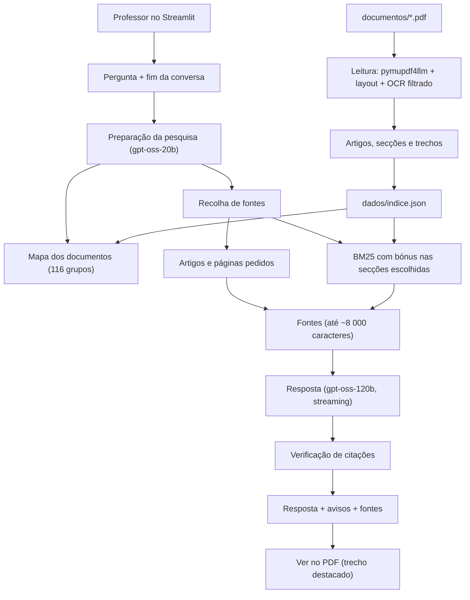

# HNCHBOT

<div align="center">


<br><br>

[](https://www.python.org/)
[](https://streamlit.io/)
[](https://console.groq.com/)
[](https://pymupdf.readthedocs.io/)
[](https://en.wikipedia.org/wiki/Okapi_BM25)

*Assistente de consulta dos documentos oficiais do Agrupamento de Escolas Henriques Nogueira (Torres Vedras): um chatbot que responde a perguntas sobre o Regulamento Interno e o Projeto Educativo apenas com base no texto dos PDFs, indicando sempre o documento, o artigo, o número, a alínea e a página de onde veio cada informação.*

[]()

🇵🇹 Este projeto está documentado e implementado em português europeu.

</div>

---

> [!WARNING]
> **Este projeto ainda está em desenvolvimento ativo.**
> A leitura dos documentos, a pesquisa, as respostas e a verificação de citações já funcionam e estão cobertas por uma bateria de 62 perguntas com respostas tiradas dos PDFs reais. A prioridade é a **precisão das respostas**; a aparência da interface fica para uma fase posterior.

---

> [!NOTE]
> **Contexto:** o projeto começou como um chatbot de Físico-Química (FQ) para fazer perguntas sobre vários PDFs de apoio (os PDFs de exemplo ainda se geram com `exemplos/gerar_pdfs_exemplo.py`). Evoluiu para uma demonstração destinada a um professor do agrupamento, que precisa de consultar rapidamente o **Regulamento Interno** (160 páginas, 274 artigos) e o **Projeto Educativo 2022/2025** (24 páginas), sem ter de procurar à mão em documentos longos.

---

## Índice

- [Sobre](#-sobre)
- [Funcionalidades](#-funcionalidades)
- [Tecnologias](#️-tecnologias)
- [Leitura dos documentos](#-leitura-dos-documentos)
- [Motor de pesquisa](#-motor-de-pesquisa)
- [Pipeline de IA](#-pipeline-de-ia)
- [Verificação de citações](#️-verificação-de-citações)
- [Testes e resultados](#-testes-e-resultados)
- [Estado do projeto](#-estado-do-projeto)
- [Pré-requisitos](#-pré-requisitos)
- [Como começar](#-como-começar)
- [Configuração](#️-configuração)
- [Estrutura do projeto](#-estrutura-do-projeto)
- [Arquitetura](#️-arquitetura)
- [Roadmap](#️-roadmap)
- [Limitações conhecidas](#️-limitações-conhecidas)
- [O que aprendi](#-o-que-aprendi)

---

## 🧩 Sobre

O HNCHBOT é um assistente de documentos feito em Python e Streamlit. O professor escreve uma pergunta em linguagem normal, por exemplo *"Quantas faltas injustificadas pode dar um aluno do 1.º ciclo?"*, *"O que diz o artigo 120.º?"* ou *"Quais são as metas do eixo 3 do Projeto Educativo?"*, e o chatbot:

1. procura nos PDFs os artigos, secções, páginas ou tabelas que respondem à pergunta;
2. envia **só esses trechos** a um modelo de linguagem da [Groq](https://console.groq.com);
3. escreve a resposta citando a fonte (`[1]`, artigo, n.º, alínea);
4. confirma que todo o texto que a resposta põe entre aspas existe mesmo nas fontes, e avisa quando não existe;
5. mostra as fontes usadas e permite abrir a página original do PDF com o trecho destacado a amarelo.

O chatbot **não usa conhecimento externo**: se a resposta não estiver nos documentos, diz *"Não encontrei essa informação nos documentos."* em vez de inventar. Funciona com quaisquer PDFs colocados na pasta `documentos/`, incluindo PDFs digitalizados e texto dentro de imagens (lidos com OCR), mas foi afinado e testado com os dois documentos do agrupamento.

---

## ✨ Funcionalidades

| Componente / Funcionalidade | Descrição | Estado |
|-----------------------------|-----------|--------|
| 📄 **Leitura precisa dos PDFs** | `pymupdf4llm` com análise de layout (`pymupdf-layout`): parágrafos, títulos, listas (`1 —`, `a)`) e tabelas em markdown, com limpeza de cabeçalhos, rodapés, índices e palavras coladas. | ✅ Concluído |
| 🖼️ **Texto em imagens (OCR)** | PDFs digitalizados e texto dentro de imagens (avisos, citações, esquemas, capturas de ecrã, botões no meio do texto) são lidos com OCR em português, com o Tesseract que vem no PyMuPDF. Só entra o texto que passa um filtro de qualidade: logótipos repetidos, fotografias e nuvens de palavras são descartados. As páginas e as fontes lidas por OCR ficam assinaladas. | ✅ Concluído |
| 🧱 **Estrutura em artigos** | O Regulamento Interno fica dividido nos 274 artigos (o 58.º existe como 58.º-A e 58.º-B), cada um com capítulo, secção e subsecção. O Projeto Educativo fica dividido pelos títulos. | ✅ Concluído |
| 🔎 **Pesquisa BM25 em português** | Pesquisa por palavras sem embeddings (a Groq não os tem), com normalização de acentos, plurais e género e palavras comuns ignoradas. | ✅ Concluído |
| 🗺️ **Mapa dos documentos para a IA** | Um modelo pequeno escolhe capítulos e secções num mapa compacto (116 grupos, ~2 200 tokens) e sugere palavras-chave como estariam escritas nos documentos. | ✅ Concluído |
| 📌 **Artigos e páginas pedidos** | *"artigo 120.º"*, *"art. 58.º-A"*, *"artigos 44 e 45"*, *"página 80"* ou *"pág. 3 a 5"* trazem o artigo ou a página inteiros (com parágrafos numerados `§1`, `§2`, ...). | ✅ Concluído |
| 💬 **Perguntas de seguimento** | *"E o artigo seguinte?"*, *"E o 9.º?"* ou *"E quanto tempo dura o mandato dele?"* são reescritas tendo em conta a conversa. | ✅ Concluído |
| 🧾 **Respostas com citações** | Cada informação leva o número da fonte `[n]` e, no regulamento, o artigo, o número e a alínea. Transcrições entre aspas seguidas de explicação simples. | ✅ Concluído |
| 🛡️ **Verificação de citações** | O texto citado na resposta (entre aspas ou em linhas `> ...`) é procurado nas fontes; se não estiver lá, aparece um aviso discreto por baixo da resposta. | ✅ Concluído |
| 🔍 **Ver no PDF** | Abre a página original com o trecho usado destacado a amarelo. | ✅ Concluído |
| 📥 **Adicionar PDFs na app** | Arrastar PDFs para a barra lateral; o índice é refeito automaticamente quando a pasta muda. | ✅ Concluído |
| 🎛️ **Filtros e definições** | Pesquisar só em alguns documentos, escolher o modelo, o número de trechos (3 a 10) e a temperatura. | ✅ Concluído |
| 🧪 **Bateria de 62 perguntas** | Perguntas com respostas tiradas dos PDFs reais: verifica fontes, factos, pesquisa sem IA e citações. | 🔨 Em curso (falta uma volta completa com o código final) |
| 🧩 **Artigos que remetem para outras alíneas** | Respostas que estão num número que só diz *"o disposto na alínea r)"* (ex.: sanções pelo uso do telemóvel). | 📋 Planeado |
| 🧠 **Descrição de gráficos e esquemas** | Um modelo com visão (o `qwen/qwen3.8-27b` da Groq aceita imagens) descreve gráficos, esquemas e fotografias, que o OCR só lê palavra a palavra. | 📋 Planeado |
| 🎨 **Aparência da interface** | Melhorar o aspeto visual da app. | 📋 Planeado |

---

## 🛠️ Tecnologias

| Tecnologia | Papel |
|------------|-------|
| Python 3.10+ | Linguagem de todo o projeto |
| Streamlit | Interface de chat, barra lateral, fontes e visualização das páginas |
| Groq API | Modelos de linguagem: preparação da pesquisa e respostas |
| `openai/gpt-oss-120b` | Modelo que escreve as respostas (por defeito) |
| `openai/gpt-oss-20b` | Modelo que prepara a pesquisa (reescrita, palavras-chave, secções) |
| `qwen/qwen3.8-27b` | Modelo de reserva quando o limite do anterior acaba |
| PyMuPDF | Abertura dos PDFs, grelhas das tabelas, palavras de cada página, imagens das páginas |
| pymupdf4llm + pymupdf-layout | Conversão das páginas em markdown com análise de layout |
| Tesseract (incluído no PyMuPDF) | OCR em português de páginas digitalizadas e de texto dentro de imagens, com o modelo `tessdata/por.traineddata` |
| BM25 (implementação própria) | Pesquisa por palavras nos trechos, adaptada ao português |
| python-dotenv | Leitura da chave da Groq a partir do ficheiro `.env` |
| JSON (`dados/indice.json`) | Cache dos PDFs já lidos, para o chatbot abrir logo |

---

## 📄 Leitura dos documentos

Para responder com precisão, o mais importante é ler bem os PDFs. Cada PDF é lido uma única vez (cerca de 1 minuto por cada 150 páginas; as páginas que precisam de OCR demoram alguns segundos cada) e o resultado fica guardado em `dados/indice.json`. Só volta a ser lido se o ficheiro mudar (tamanho ou data de modificação).

| Passo | O que acontece |
|-------|----------------|
| **1. Texto e layout** | O `pymupdf4llm`, com a análise de layout do `pymupdf-layout`, converte cada página em markdown: junta as linhas em parágrafos e reconhece títulos, listas e tabelas. As páginas são lidas em lotes de 10 para mostrar o progresso. |
| **2. OCR** | Antes da conversão, as imagens de cada página são lidas com OCR em português a 300 dpi, sem o texto nativo da página: nas páginas digitais, cada imagem com pelo menos 24 × 8 pt (o que inclui botões no meio do texto) é lida em separado, e imagens sobrepostas (uma janela por cima de outra) são juntas numa só zona; nas páginas digitalizadas (menos de 20 palavras nativas), a página inteira. As imagens que se repetem em metade ou mais das páginas (logótipos e fotografias de cabeçalho e rodapé) são ignoradas. Cada linha lida tem de ter pelo menos 75% de palavras plausíveis (letras ou números, sem misturas como *"ooNesORA"* ou *"4r4"*) e cada imagem pelo menos 70% de linhas plausíveis; o resto é descartado. As linhas aceites entram na página como texto invisível e seguem os passos seguintes. O título do documento é lido antes do OCR. |
| **3. Palavras coladas** | Palavras que o PDF juntou (ex.: *"residenteporgrandesgrupos"*) são separadas com base nas palavras que existem mesmo na página. |
| **4. Tabelas** | Se uma tabela sai com palavras partidas entre células (cabeçalhos na vertical, células fundidas), é trocada pela leitura da grelha da própria tabela. As células fundidas na vertical repetem o rótulo (ex.: *"1.º Ciclo"* em cada ano). |
| **5. Limpeza** | Saem os cabeçalhos e rodapés repetidos (*"Regulamento Interno AEHN · Página 80 de 160"*) e as páginas de índice (*"Artigo 3.º (Objetivos) ........ 18"*). Títulos e parágrafos partidos pelo fim da linha ou da página são juntados. |
| **6. Estrutura** | Os títulos *Capítulo*, *Secção*, *Subsecção* e *Artigo* formam a hierarquia. O nome do artigo que vem na linha seguinte (*"(Definição)"*) junta-se ao título. Nos outros documentos, as secções são definidas pelos títulos. |
| **7. Trechos** | Cada secção é dividida em trechos de ~1 800 caracteres sem partir parágrafos. As tabelas grandes são divididas por linhas e repetem o cabeçalho em cada parte. Trechos quase vazios (ex.: a capa) não entram na pesquisa. |
| **8. Verificação** | As palavras lidas são comparadas com as do PDF. Se faltarem 5 ou mais palavras numa página, aparece um aviso na barra lateral e no `indexar.py`. |

**Resultado atual da leitura:**

| Documento | Páginas | Secções | Artigos | Trechos |
|-----------|---------|---------|---------|---------|
| Regulamento Interno (`regulamento-interno-aehn_2025.pdf`) | 160 | 277 | 275 secções de artigo (1.º a 274.º, com 58.º-A e 58.º-B) | 346 |
| Projeto Educativo (`pe-22_25_vdefinitiva.pdf`) | 24 | 22 | — | 33 |
| **Total** | **184** | **299** | | **379** |

Foram reconhecidas 25 tabelas e não há avisos de leitura (com o PyMuPDF 2.0, as fórmulas da TPS e da TCD da página 4 do Projeto Educativo passaram a ser lidas). O OCR acrescentou texto em 4 páginas do Projeto Educativo: a citação da página 5, os projetos da página 6, os departamentos do organograma da página 14 e o esquema da missão da página 18. A capa (nuvem de palavras), as fotografias e o mapa foram lidos, mas o filtro descartou-os. O Regulamento Interno não tem imagens com texto.

---

## 🔎 Motor de pesquisa

A Groq não tem modelos de embeddings, por isso a pesquisa é feita por palavras com **BM25**, e a parte "por significado" vem da IA, que escolhe as secções a partir do mapa dos documentos.

A pontuação de cada trecho `D` para a pergunta `Q` é:

```
                           f(q, D) · (k1 + 1)
BM25(D, Q) = Σ IDF(q) · ─────────────────────────────────────────
             q∈Q          f(q, D) + k1 · (1 − b + b · |D| / média)

IDF(q) = ln( 1 + (N − n(q) + 0,5) / (n(q) + 0,5) )
```

| Símbolo | Significado | Valor |
|---------|-------------|-------|
| `f(q, D)` | número de vezes que a palavra `q` aparece no trecho (o título da secção conta duas vezes) | contado |
| `|D|` e `média` | tamanho do trecho e tamanho médio dos trechos, em palavras | contado |
| `N`, `n(q)` | número de trechos e número de trechos com a palavra `q` | 378, contado |
| `k1` | saturação da frequência | 1,5 |
| `b` | normalização pelo tamanho | 0,75 |

**Adaptações ao português** (`rag/texto.py`):

- minúsculas e sem acentos (*"Reações"* → *"reacoes"*);
- plurais e género reduzidos (*"reações"*/*"reação"* → *"reaca"*, *"forças"* → *"forc"*);
- palavras com hífen contam separadas e juntas (*"ácido-base"* → *"acido"*, *"base"*, *"acidobase"*);
- palavras muito comuns (*"de"*, *"que"*, *"documento"*, *"página"*, ...) são ignoradas;
- referências como *"página 12"*, *"artigo 120.º"* ou *"2.º parágrafo"* são retiradas da pesquisa, porque esses números não ajudam a encontrar o texto;
- as palavras dos títulos dos documentos (*"regulamento interno"*) servem para escolher o documento, não para pesquisar dentro dele.

**Como as fontes são escolhidas** (`recolher_fontes` em `rag/assistente.py`):

1. **Artigos pedidos** — escritos na pergunta ou, numa pergunta de seguimento, indicados pela IA. Vão inteiros.
2. **Pesquisa BM25** — com a pergunta, a pergunta reescrita e as palavras-chave da IA (estas valem metade). Os trechos das secções escolhidas pela IA recebem um bónus de **×1,6** e os do documento identificado **×1,3**. Ficam os 6 melhores (ajustável de 3 a 10) com pelo menos 25% da pontuação do primeiro.
3. **Páginas pedidas** — a página inteira, com os parágrafos numerados. Quando se pede um artigo ou uma página, só ficam 2 resultados da pesquisa, como contexto.
4. **Limite de tamanho** — até ~8 000 caracteres de fontes (~2 500 tokens), por causa do limite de 8 000 tokens por minuto do plano gratuito da Groq.

---

## 🤖 Pipeline de IA

Cada pergunta passa por dois modelos da Groq e por uma verificação local:

```
Pergunta do professor (+ fim da conversa)
          │
          ▼
  Preparação da pesquisa (openai/gpt-oss-20b, JSON)
  pergunta reescrita · palavras-chave · grupos do mapa
  documento · artigos · páginas
          │
          ▼
  Recolha de fontes (local)
  artigos/páginas pedidos + BM25 com bónus
          │
          ▼
  Resposta (openai/gpt-oss-120b, streaming)
  só com as fontes · cita [n], artigo, n.º, alínea
          │
          ▼
  Verificação de citações (local)
  o texto citado existe nas fontes?
          │
          ▼
  Resposta + avisos + fontes + "Ver no PDF"
```

| Etapa | Modelo | Configuração | Função |
|-------|--------|--------------|--------|
| **Preparação da pesquisa** | `openai/gpt-oss-20b` (reserva: `qwen/qwen3.8-27b`, `llama-3.1-8b-instant`) | temperatura 0, JSON obrigatório, raciocínio *low* | Reescreve a pergunta sem depender da conversa, sugere 4 a 10 palavras-chave no vocabulário formal dos regulamentos (*"até quando"* → *"prazo"*, *"dias úteis"*; *"quem decide"* → *"compete"*), escolhe até 3 grupos do mapa e identifica o documento, os artigos e as páginas. |
| **Resposta** | `openai/gpt-oss-120b` (ou outro escolhido na barra lateral) | temperatura 0,1, raciocínio *medium*, streaming | Responde só com as fontes, com números, prazos e unidades exatamente como no texto, cita cada informação, transcreve entre aspas quando pedem o que diz um artigo, indica todos os itens das alíneas, confirma linha e coluna nas tabelas e responde em português europeu. |
| **Verificação** | nenhum (código local) | — | Procura nas fontes o texto citado e devolve as citações que não encontrou. |

A lista de modelos é pedida à API da Groq quando o chatbot abre (os modelos Llama de resposta já foram retirados pela Groq). Se o limite de um modelo de preparação acabar, passa automaticamente ao seguinte.

**Regras principais dadas ao modelo que responde:**

- responder **apenas** com base nas fontes, sem conhecimento externo sobre leis ou outras escolas;
- ser preciso: *"dez dias"* não é o mesmo que *"dez faltas"*; não arredondar nem generalizar;
- citar sempre `[n]` e, nos artigos, *(artigo 118.º, n.º 1, alínea a))*;
- se só houver resposta para parte da pergunta, dizer claramente o que não encontrou;
- se não houver resposta, dizer só *"Não encontrei essa informação nos documentos."* e sugerir indicar o artigo ou a página;
- nunca sugerir outros documentos que não estejam nas fontes;
- escrever em português europeu (*"facto"*, *"equipa"*, *"tu fazes"*), nunca em português do Brasil.

---

## 🛡️ Verificação de citações

Os modelos de linguagem podem "citar" frases que não existem. Por isso, depois de cada resposta, o chatbot procura nas fontes todo o texto que a resposta apresenta como citação:

- texto entre aspas: `“...”`, `«...»` e `"..."`;
- linhas citadas em markdown (`> 1 — O aluno...`), que é a forma que o modelo mais usa para transcrever artigos inteiros.

Se uma citação não estiver nas fontes, aparece por baixo da resposta:

> Atenção: esta citação não foi encontrada nas fontes: «...»

A resposta nunca é bloqueada: o aviso só diz ao professor para confirmar aquela frase no PDF.

**Como a comparação funciona** (`verificar_citacoes` em `rag/assistente.py`):

| É ignorado na comparação | Exemplo |
|--------------------------|---------|
| Maiúsculas, acentos e pontuação | *"Ação"* = *"acao"* |
| Markdown e etiquetas | `**negrito**`, `<br>`, `<mark>`, tabelas `|` |
| Marcadores de listas | `a)`, `ii)`, `1 —` |
| Números das fontes e referências | `[1]`, *(artigo 118.º, n.º 1)* |
| Numeração das páginas completas | `§3`, *(título)* |

| É aceite | Porquê |
|----------|--------|
| Omissões `...`, `…`, `(…)`, `[…]` | Cada parte da citação é procurada separadamente |
| Texto das fontes das últimas respostas | O modelo vê a conversa anterior |
| Texto da própria pergunta | Repetir a pergunta não é inventar |
| Citações com menos de 3 palavras | São termos soltos (*"Kit Digital"*), não transcrições |

Nos testes, o verificador apanhou um caso real: o modelo citou entre aspas *"sanções disciplinares imputadas ao comportamento do aluno"*, quando o artigo 128.º diz *"uma sanção disciplinar imputada ao comportamento do aluno"*.

---

## 🧪 Testes e resultados

`testes/avaliar.py` faz **62 perguntas** aos documentos reais. Cada pergunta tem a fonte esperada e os factos esperados tirados do texto dos PDFs. Antes de entrar na bateria, cada pergunta foi confirmada: a fonte esperada existe no índice e cada facto esperado aparece no texto dessa fonte.

| Grupo | Perguntas | Exemplos |
|-------|-----------|----------|
| Iniciais | 23 | faltas no 1.º ciclo, *"O que diz o artigo 120.º?"*, composição do Conselho Geral, página 80, tabelas do PE, sigla EMAEI, salário de um professor (sem resposta) |
| Palavras diferentes das do texto | 16 | *"Quem fica no lugar do diretor quando ele está ausente?"*, *"Há regras sobre a roupa?"* (*vestuário*), *"transferido de escola como castigo"* (*medida disciplinar sancionatória*), *"quanto custa a segunda via do cartão?"* (o valor não está no texto) |
| Juntar 2 ou 3 artigos | 5 | diferença entre medidas corretivas e sancionatórias (art. 126.º e 128.º), mandatos do diretor e do Conselho Geral (art. 17.º e 10.º), quem aprova o PE e quando |
| Tabelas do Projeto Educativo | 10 | alunos de Línguas e Humanidades no 10.º ano, escalão A da ASE, taxa de transição do 2.º ano dos cursos profissionais, população do Ramalhal |
| Seguimento | 5 | *"Quantos alunos tinha o 7.º ano?"* → *"E o 9.º?"*; *"Quem elege o diretor?"* → *"E quanto tempo dura o mandato dele?"* → *"Pode ser reconduzido para um terceiro mandato?"* |
| Sem resposta nos documentos | 3 | propina dos cursos profissionais, férias dos professores, telefone da escola sede |

**O que é verificado em cada pergunta:**

| Verificação | Como |
|-------------|------|
| **Fonte** | O artigo, a secção ou a página certa chegou ao modelo (ou todas, quando a resposta junta vários artigos). |
| **Resposta** | A resposta contém os factos esperados, sem acentos, com vírgula decimal igual a ponto e `0,5 %` igual a `0.5%`. Cada facto pode ter alternativas (*"dez dias"* ou *"10 dias"*). |
| **Só BM25** | A pesquisa por palavras, sem a ajuda da IA, também encontrava a fonte. |
| **Citações** | Quantas citações foram verificadas e quais não estão nas fontes. |

```bash
python testes/avaliar.py            # todas (~35 min, por causa do limite por minuto da Groq)
python testes/avaliar.py 1 2 3      # só algumas
python testes/testar_imagens.py     # leitura de imagens com OCR (~15 s, sem Groq)
python testes/verificar_leitura.py  # texto + imagens de todos os PDFs de documentos/ (sem Groq)
python testes/verificar_leitura.py C:\pasta\com\pdfs   # ou de outra pasta
```

As respostas completas, as fontes e as citações não encontradas ficam em `dados/avaliacao.json`. Se o limite diário da Groq acabar a meio, a bateria pára e mostra o resumo do que já fez.

`testes/testar_imagens.py` cria 7 PDFs de teste (aviso em imagem numa página com texto, documento digitalizado, gráfico em imagem, esquema desenhado com texto, botão em imagem no meio de uma frase, captura de ecrã numa página com muito texto e logótipo repetido em todas as páginas) e confirma que o texto de cada um é lido, que o logótipo repetido é ignorado, que o *Ver no PDF* destaca o trecho numa página digitalizada e que o filtro do OCR aceita e rejeita as linhas certas (com exemplos tirados do OCR real do Projeto Educativo). Não usa a Groq e termina com código 1 se alguma verificação falhar.

`testes/verificar_leitura.py` verifica PDFs reais (por defeito, os de `documentos/`). Para cada PDF, lê-o como a app e confirma duas coisas:

- **Texto nativo:** pelo menos 97% das palavras do PDF estão no índice. Não contam os cabeçalhos e rodapés repetidos nem as linhas do índice, que a leitura retira de propósito.
- **Imagens:** cada imagem é lida outra vez com OCR, independentemente da leitura. Se o filtro de qualidade aceita o texto dela, pelo menos 80% desse texto tem de estar no índice da página.

Mostra também quantas imagens não tinham texto legível e quantas foram ignoradas por se repetirem. Não usa a Groq e termina com código 1 se algum PDF falhar.

**Validação com manuais reais (27/10/2026).** A leitura de imagens foi validada com 24 manuais de utilizador da plataforma Inovar Alunos: 192 páginas cheias de capturas de ecrã e de botões em imagem no meio do texto. Os manuais não estão no repositório, porque têm direitos reservados. Na primeira versão do OCR, quem decidia que páginas ler era o `pymupdf4llm`, que só lia imagens com pelo menos 2% da página: o OCR nem corria em 13 dos 24 manuais e a maioria das capturas ficava de fora. Com a versão atual:

| Medida | Resultado |
|--------|-----------|
| `testes/verificar_leitura.py` | 24/24 PDFs sem falhas (e o PE e o RI também) |
| Texto nativo no índice | 100% em todos os manuais |
| Imagens lidas | 116, em 70 páginas |
| Imagens sem texto legível | 160 (ícones, fotografias e capturas com letra pequena ou de baixa resolução) |
| Imagens repetidas ignoradas | 461 (logótipos e fotografias de cabeçalho e rodapé) |
| Perguntas cuja resposta só está nas imagens (só pesquisa BM25) | página certa em 7/8 com OCR, contra 2/8 sem OCR |
| As mesmas perguntas com a Groq (2 testadas) | 2/2 respondidas com a informação da captura de ecrã |

### Resultados

| Volta | Código | Fontes certas | Respostas certas | Só BM25 | Citações verificadas | Não encontradas |
|-------|--------|---------------|------------------|---------|----------------------|-----------------|
| 18/10/2026 | 23 perguntas iniciais | 23/23 | 23/23 (22/23 antes de corrigir um teste demasiado estrito) | — | — | — |
| 20/10/2026, 1.ª volta | antes das correções | 59/62 | **56/62** (23/23 das iniciais) | 52/62 | 65 | 1 (falso aviso, corrigido) |
| 20/10/2026, 2.ª volta | com as correções | 19/20 corridas | **19/20** corridas | 16/20 | 45 | 1 (citação no plural) |
| 27/10/2026, amostra | PyMuPDF 2.0, sem OCR | 4/4 corridas (1, 13, 17, 21) | **4/4** | 4/4 | 12 | 1 (erro real do modelo: *"respetado"* em vez de *"respetivo"*) |
| 27/10/2026, amostra | com OCR (versão final) | 4/4 corridas (1, 14, 17, 22) | **4/4** | 4/4 | 8 | 0 |

A 2.ª volta repetiu as 6 perguntas que falharam (5 passaram a certas) e as perguntas 1 a 14 (14/14). Parou na pergunta 15 porque acabou o limite diário de tokens da Groq.

**As 6 falhas da 1.ª volta e o que foi feito:**

| Pergunta | Problema | Correção | Estado |
|----------|----------|----------|--------|
| 25. *Até quando posso justificar uma falta?* | O prazo está no n.º 6 do art. 116.º (*"até ao 3.º dia útil"*), num trecho que ficou de fora pelo limite de tamanho; faltava a palavra *"prazo"* na pesquisa. | Preparação da pesquisa com vocabulário de prazos (*"prazo"*, *"dias úteis"*). | ✅ Certa |
| 27. *Há regras sobre a roupa?* | O modelo pequeno procurou *"vestimenta"* e *"uniforme"* em vez de *"vestuário"*. | Vocabulário formal de Portugal, não o do dia a dia nem o do Brasil. | ✅ Certa |
| 34. *Quem decide se um aluno é transferido de escola?* | Escolheu as secções do diretor e dos conselhos em vez das medidas sancionatórias. | Palavras para *"quem decide"* (*"compete"*, *"competência"*) e grupos de capítulos diferentes em caso de dúvida. | ✅ Certa |
| 38. *O que acontece a um aluno que insiste em usar o telemóvel?* | A sanção está no n.º 6 do art. 111.º, que só diz *"o disposto na alínea r)"* e nunca *"telemóvel"*. | — | ❌ Ainda falha |
| 40. *Diferença entre medidas corretivas e sancionatórias* | As fontes estavam certas, mas a resposta não listou a repreensão registada. | Instrução para indicar todos os itens enumerados nas alíneas. | ✅ Certa |
| 47. *Quantos alunos tinham escalão A?* | O modelo pequeno escolheu os artigos da ASE do Regulamento em vez da tabela do Projeto Educativo. | Indicação de que números e metas costumam estar no Projeto Educativo. | ✅ Certa |

---

## 📈 Estado do projeto

### Linha do tempo

| Data | Fase | O que foi feito |
|------|------|-----------------|
| 18/10/2026 | **Chatbot de FQ para vários PDFs** | Leitura dos PDFs com PyMuPDF por página e parágrafo, com cache em `dados/`; pesquisa BM25 adaptada ao português; reescrita da pergunta com um modelo pequeno (perguntas de seguimento); deteção de *"página N"* com a página completa e os parágrafos numerados; respostas com citações `[n]` e vista da página com o trecho destacado; lista de modelos pedida à API; interface Streamlit e `iniciar.bat`. |
| 18/10/2026 | **Leitura precisa do Regulamento Interno e do Projeto Educativo** | `pymupdf4llm` + `pymupdf-layout`; tabelas reconstruídas pela grelha; limpeza de cabeçalhos, rodapés, índices e palavras coladas; divisão nos 274 artigos com capítulo, secção e subsecção; *"artigo N"* e *"página N"* trazem o texto inteiro; mapa compacto para a IA escolher secções; primeira bateria de 23 perguntas (23/23). |
| 20/10/2026 | **Fiabilidade das respostas** | Verificação de citações com aviso na app; bateria alargada para 62 perguntas; correções na preparação da pesquisa e nas instruções de resposta; mensagem própria para o limite diário da Groq; resultados guardados em `dados/avaliacao.json`. |
| 20/10/2026 | **Limpeza e documentação** | Código sem comentários nem emojis, ficheiros de configuração simplificados, logótipo do agrupamento e este README. |
| 27/10/2026 | **Leitura de imagens (OCR)** | OCR em português com o Tesseract do PyMuPDF (modelo em `tessdata/`), feito pelo próprio projeto antes da conversão: cada imagem a partir de 24 × 8 pt nas páginas digitais (incluindo botões), a página inteira nas digitalizadas, sem logótipos repetidos e com imagens sobrepostas juntas; filtro de qualidade por linha e por imagem; título do documento lido antes do OCR; páginas e fontes lidas por OCR assinaladas na app e para o modelo; *Ver no PDF* com destaque em páginas digitalizadas; testes `testes/testar_imagens.py` e `testes/verificar_leitura.py`, validados com 24 manuais com capturas de ecrã; PyMuPDF 2.0. |

### Onde estamos

- A leitura dos dois documentos está estável: 379 trechos, 25 tabelas e nenhum aviso de leitura.
- PDFs digitalizados e texto dentro de imagens já são lidos com OCR (no PE: a citação da página 5, os projetos da página 6 e o esquema da página 18). Gráficos e esquemas são lidos palavra a palavra, sem o significado.
- Das 62 perguntas, 56 estavam certas antes das correções; com as correções, todas as que foram repetidas estão certas exceto a 38.
- Falta repetir as perguntas 15 a 62 com o código final. A bateria completa gasta quase todo o limite diário gratuito da Groq, por isso só se pode correr uma vez por dia.
- A interface funciona, mas o aspeto visual ainda não foi trabalhado.

### Próximos passos

1. Correr a bateria completa com o código final quando o limite diário da Groq recuperar.
2. Resolver a pergunta 38: quando um trecho de um artigo é escolhido, trazer também os outros números do mesmo artigo, sem tirar lugar às fontes de outros artigos. Uma primeira experiência resolveu a pergunta 25 mas, com um plano mau, tirava a fonte certa da pergunta 11, por isso não ficou.
3. Mudar automaticamente de modelo de resposta quando o `gpt-oss-120b` atinge o limite diário.
4. Descrever gráficos, esquemas e fotografias com um modelo com visão (o `qwen/qwen3.8-27b` da Groq aceita imagens) e guardar a descrição no índice.
5. Trabalhar a aparência da interface.

---

## 📦 Pré-requisitos

- Python 3.10 ou superior
- Uma conta na [Groq](https://console.groq.com) e uma chave da API (o plano gratuito chega para a demonstração)
- Os PDFs a consultar (os documentos do agrupamento não estão no repositório)
- Nada a instalar para o OCR: o motor do Tesseract vem no PyMuPDF e o modelo de português está em `tessdata/`
- Windows para o arranque com duplo clique (`iniciar.bat`); noutros sistemas, a instalação manual

---

## 🚀 Como começar

**1. Clonar o repositório**

```bash
git clone https://github.com/EduhxH/HNCHBOT.git
cd HNCHBOT
```

**2. Colocar os PDFs**

Copiar os PDFs para a pasta `documentos/` (podem estar em subpastas). Também se podem arrastar mais tarde para o campo **Adicionar PDFs** na barra lateral. Para testar sem os documentos reais:

```bash
python exemplos/gerar_pdfs_exemplo.py
```

Este comando cria 3 PDFs de exemplo de Físico-Química (*Movimentos e Forças*, *Reações Químicas*, *Átomos e Tabela Periódica*).

**3a. Opção rápida (Windows)**

1. Fazer duplo clique em **`iniciar.bat`**. Da primeira vez, cria o ambiente virtual e instala as dependências.
2. Abrir o ficheiro `.env` que foi criado e colocar a chave da Groq.
3. O chatbot abre no browser em http://localhost:8501

**3b. Opção manual**

```bash
python -m venv .venv
.venv\Scripts\activate          # Linux/Mac: source .venv/bin/activate
pip install -r requirements.txt
copy .env.example .env          # Linux/Mac: cp .env.example .env
python indexar.py               # opcional: lê os PDFs mostrando o progresso
streamlit run app.py
```

Sem chave da Groq, o chatbot funciona em modo de pesquisa: mostra os trechos e as páginas encontrados, mas não escreve respostas.

Se o ambiente virtual foi criado antes de 27/10/2026, atualiza as dependências, porque o OCR precisa do PyMuPDF 2.0 (o `iniciar.bat` só as instala da primeira vez):

```bash
.venv\Scripts\python.exe -m pip install -U -r requirements.txt
```

---

## ⚙️ Configuração

**`.env`**

```env
GROQ_API_KEY=gsk_...
GROQ_MODELO=
```

| Variável | Obrigatória | Descrição |
|----------|-------------|-----------|
| `GROQ_API_KEY` | Sim | Chave criada em https://console.groq.com/keys. Também se pode colar na barra lateral, no campo *Chave da API Groq*. |
| `GROQ_MODELO` | Não | Modelo usado para responder. Vazio = o primeiro disponível de `openai/gpt-oss-120b`, `llama-3.3-70b-versatile`, `qwen/qwen3.8-27b`, `openai/gpt-oss-20b`. |

**Definições na barra lateral**

| Definição | Valor por defeito | Efeito |
|-----------|-------------------|--------|
| Pesquisar só em | todos os documentos | Limita a pesquisa aos PDFs escolhidos |
| Modelo | `openai/gpt-oss-120b` | Modelo que escreve as respostas |
| Trechos por pergunta | 6 (de 3 a 10) | Número máximo de resultados da pesquisa |
| Criatividade (temperatura) | 0,1 | Valores baixos dão respostas mais fiéis ao texto |
| Limpar conversa | — | Apaga o histórico (as perguntas de seguimento deixam de ter contexto) |

---

## 📂 Estrutura do projeto

```
HNCHBOT/
├── app.py                      # Interface Streamlit: chat, fontes, avisos de citações, barra lateral
├── indexar.py                  # Lê os PDFs pelo terminal, com progresso e estatísticas
├── iniciar.bat                 # Instala e abre o chatbot no Windows com duplo clique
├── requirements.txt            # Dependências Python
├── .env.example                # Modelo do ficheiro .env
├── .streamlit/
│   └── config.toml             # Arranque sem o pedido de email do Streamlit
├── assets/
│   └── logo.svg                # Logótipo do Agrupamento de Escolas Henriques Nogueira
├── rag/
│   ├── pdfs.py                 # Leitura dos PDFs: markdown, OCR, tabelas, limpeza, verificação
│   ├── estrutura.py            # Divisão em capítulos, secções, artigos e trechos
│   ├── indice.py               # Cache em dados/, pesquisa BM25, mapa dos documentos
│   ├── texto.py                # Português: acentos, plurais, "página 12", "artigo 58.º-A"
│   └── assistente.py           # Groq: preparar a pesquisa, escolher fontes, responder, verificar citações
├── tessdata/
│   ├── por.traineddata         # Modelo de OCR em português (tessdata_fast do Tesseract)
│   └── LICENSE                 # Licença do modelo (Apache 2.0)
├── testes/
│   ├── avaliar.py              # Bateria de 62 perguntas com respostas verificadas
│   ├── testar_imagens.py       # Leitura de imagens com OCR, com PDFs de teste (sem Groq)
│   └── verificar_leitura.py    # Verifica texto + imagens de PDFs reais (sem Groq)
├── exemplos/
│   └── gerar_pdfs_exemplo.py   # Cria 3 PDFs de exemplo de Físico-Química
├── documentos/                 # PDFs a consultar (não vão para o repositório)
└── dados/                      # Gerado: indice.json (cache) e avaliacao.json (resultados dos testes)
```

---

## 🏗️ Arquitetura

```
Browser (Streamlit)
      │
      ├── pergunta  ──────────────►  app.py
      └── "Ver no PDF"  ◄──────────  página renderizada com o trecho destacado
                                        │
                     ┌──────────────────┼──────────────────────┐
                     ▼                  ▼                      ▼
              rag/indice.py      rag/assistente.py       rag/pdfs.py
              cache + BM25       preparar · recolher     leitura e imagens
              mapa dos docs      responder · verificar   das páginas
                     │                  │
                     ▼                  ▼
            dados/indice.json      Groq API
            (PDFs já lidos)        gpt-oss-20b (pesquisa)
                                   gpt-oss-120b (resposta)
```



---

## 🗺️ Roadmap

- [x] Interface Streamlit com chat, fontes e barra lateral
- [x] Leitura dos PDFs com cache em `dados/indice.json`
- [x] Pesquisa BM25 adaptada ao português
- [x] Reescrita das perguntas de seguimento
- [x] Página completa com parágrafos numerados para *"página N"*
- [x] Vista da página do PDF com o trecho destacado
- [x] Leitura com layout: parágrafos, títulos, listas e tabelas
- [x] Tabelas reconstruídas pela grelha quando o markdown sai partido
- [x] Limpeza de cabeçalhos, rodapés, índices e palavras coladas
- [x] Divisão do Regulamento Interno nos 274 artigos
- [x] Mapa dos documentos para a IA escolher secções
- [x] Artigos pedidos (*"artigo 58.º-A"*, *"artigos 44 e 45"*) inteiros
- [x] Citações com artigo, número e alínea
- [x] Verificação de citações com aviso na app
- [x] Bateria de 62 perguntas (sinónimos, vários artigos, tabelas, seguimento, sem resposta)
- [x] Mensagem própria para o limite diário da Groq
- [ ] Volta completa da bateria com o código final
- [ ] Artigos com remissões internas (pergunta 38)
- [ ] Mudança automática de modelo quando o limite diário acaba
- [x] Texto dentro de imagens com OCR filtrado (citação da página 5 do PE, fórmulas da página 4)
- [x] OCR para PDFs digitalizados
- [ ] Descrição de gráficos, esquemas e fotografias com um modelo com visão
- [ ] Aparência da interface

---

## ⚠️ Limitações conhecidas

- **Limites do plano gratuito da Groq** — 8 000 tokens por minuto e **200 000 tokens por dia** por modelo. O limite diário recupera aos poucos (~8 000 tokens por hora). Cada pergunta gasta ~3 000 tokens no modelo pequeno e ~4 000 no grande, o que dá ~50 a 60 perguntas por dia. Quando o modelo pequeno chega ao limite, a pesquisa passa a ser preparada pelo `qwen`; quando é o grande, a app avisa e pode escolher-se outro modelo na barra lateral.
- **A bateria completa gasta o limite de um dia** — só é possível uma volta completa por dia.
- **Remissões dentro de um artigo** — quando a resposta está num número que só remete para outra alínea (*"o disposto na alínea r)"*), a pesquisa pode não o encontrar (pergunta 38).
- **Preparação da pesquisa variável** — o modelo pequeno nem sempre escolhe as mesmas secções para a mesma pergunta; os bónus na pesquisa podem favorecer secções erradas quando a escolha é má.
- **Palavras da mesma família** — a redução de palavras trata plurais e género, mas *"justificar"* e *"justificação"* continuam a ser palavras diferentes para a pesquisa.
- **Imagens** — o texto dentro de imagens é lido com OCR, mas só quando a leitura é limpa: logótipos repetidos, fotografias, mapas e nuvens de palavras são descartados, tal como capturas de ecrã com letra muito pequena ou de baixa resolução (o OCR delas sai ilegível), e o texto de esquemas sai pela ordem do OCR, por vezes com palavras coladas. Imagens perto do limite de qualidade podem entrar ou não conforme pequenas diferenças na leitura. O OCR lê as palavras, não o significado: num gráfico perde-se que valor pertence a que ano, e do organograma só se aproveitam os nomes das caixas, sem a hierarquia.
- **PDFs digitalizados** — são lidos com OCR em português na primeira leitura (alguns segundos por página). O texto lido por OCR pode ter erros, por isso as fontes que vêm de OCR aparecem assinaladas; digitalizações de má qualidade podem ficar sem texto, e a barra lateral avisa.
- **Privacidade** — os trechos dos PDFs relevantes para cada pergunta são enviados para a Groq (serviço na cloud).
- **A IA pode errar** — confirmar sempre na fonte indicada (botão *Ver no PDF*).

---

## 🧠 O que aprendi

- **Ler PDFs é a parte mais difícil** — a qualidade das respostas depende sobretudo de ler bem o documento: tabelas com cabeçalhos na vertical, células fundidas, palavras coladas, cabeçalhos repetidos e artigos cujo nome vem na linha seguinte ao título.
- **Pesquisa sem embeddings** — implementar o BM25 de raiz, adaptá-lo ao português (acentos, plurais, palavras comuns) e combiná-lo com um modelo pequeno que escolhe secções num mapa compacto, para compensar a falta de pesquisa por significado.
- **Gerir um orçamento de tokens** — com 8 000 tokens por minuto e 200 000 por dia, cada decisão conta: o mapa tem só capítulos e intervalos de artigos, as fontes têm um limite de caracteres e os testes precisam de pausas entre perguntas.
- **Medir em vez de adivinhar** — uma bateria de perguntas com factos tirados dos PDFs mostra exatamente onde o chatbot falha (recolha de fontes ou resposta), e reproduzir a recolha de fontes com os planos guardados permite testar mudanças sem gastar tokens.
- **Não confiar nas citações de um modelo** — verificar automaticamente que o texto entre aspas existe nas fontes, ignorando diferenças de formatação mas não de conteúdo, apanha citações alteradas que pareciam corretas.
- **Português europeu** — os modelos tendem a usar vocabulário do dia a dia ou do Brasil (*"vestimenta"*, *"uniforme"*) e os documentos usam vocabulário formal de Portugal (*"vestuário"*); é preciso dizê-lo explicitamente nas instruções.

---

## 🤝 Contribuir

Contribuições são bem-vindas. Se encontrares um erro ou quiseres propor uma funcionalidade, abre primeiro uma *issue* para discutirmos antes de escrever código. Num *pull request*, mantém o âmbito pequeno: uma correção ou funcionalidade por PR, e corre `python testes/avaliar.py` com as perguntas afetadas.

---

## 📄 Licença

Ainda não foi escolhida uma licença. Até lá, todos os direitos estão reservados ao autor. O logótipo e os documentos pertencem ao Agrupamento de Escolas Henriques Nogueira.

---

<div align="center">
  Feito com 💜 por <a href="https://github.com/EduhxH">EduhxH</a>
</div>
